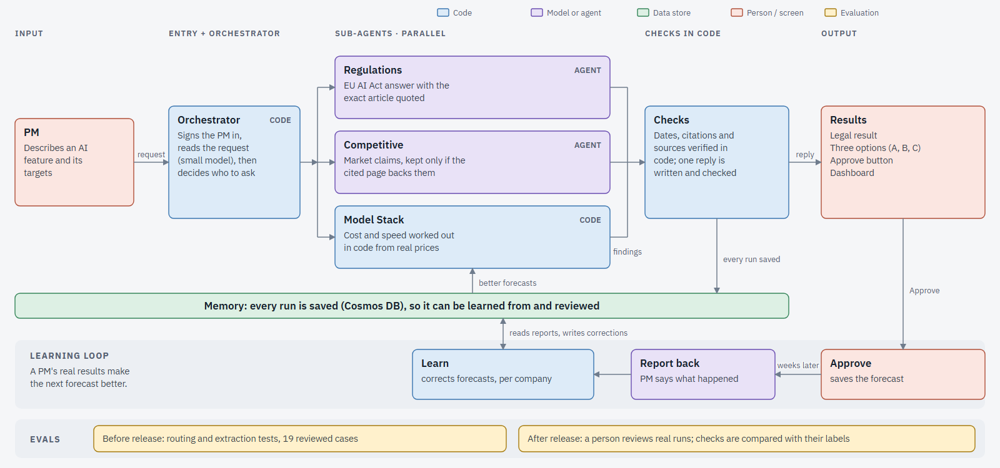

# ShipWiseAI on Foundry

Picking an AI model for a new feature is harder than it should be. As a product manager you end up with a dozen pricing pages, vendor claims nobody can verify, a competitor sheet that's already out of date, and a legal question (is this even allowed in the EU?) that nobody can answer with confidence. I built ShipWise AI to replace that scramble.

You describe the feature and what you need, for example "a billing chatbot on our help page, replies in under 800ms, under $40K a year". ShipWise comes back with three answers, each with its sources:

1. **Is it legal?** The feature is classified under the EU AI Act, quoting the Act's own text.
2. **Who else does this, and what do they charge?** A competitor table, where every claim is checked against the page it cites.
3. **Which model should run it?** Three options with yearly cost, speed and a quality ranking, each measured against your targets.

This is the second version. I first built a prototype in n8n ([ShipWiseAI-n8n](https://github.com/singhpriyankao/ShipWiseAI-n8n)) to test the reasoning. This repo is the rebuild on Azure AI Foundry, made to be something about ten people could really use: live tools, real retrieval, memory, guardrails written in code, and evaluation both before and after release.

**How it was built.** I used Claude Code as my coding assistant. The product decisions, the requirements, the test design and the review of every result are mine.

Live demo: https://shipwise-ai-beta.vercel.app (needs an account).



A more detailed diagram is in [docs/shipwise_architecture.png](docs/shipwise_architecture.png).

## See it in action

The hosted demo needs an account, so here is what a request looks like. A PM types something like:

> We want to add a billing support chatbot on our help page that answers customers' invoice and payment questions from our knowledge base. It needs to start replying in under 800ms and cost less than $40K a year.

ShipWise reads the targets, runs its analysts, and answers on one page:

- **Legal:** the feature's classification under the EU AI Act, the date the duty applies from, and the Act's own words quoted. A "not legal advice" notice is attached by code.
- **Model options:** three choices picked by code, each with yearly cost, the time until the first words appear against the latency target, and a general quality ranking labelled as a proxy. An option that misses a target says so and by how much.
- **Competitors:** the products found, and which claims could be checked against the page they cite. Claims that couldn't be checked are not shown as fact.
- **Assumptions and gaps:** the request volume and token sizes it assumed, and a plain statement that no public benchmark measures accuracy on the PM's own task.

<!--
Screenshots or a short recording go here. Add the files to docs/media/ and uncomment, for example:


Suggested shots, in order: the request being typed, the live plan while the analysts run, the legal banner with the quoted Article, the three option cards, the competitor table showing what was and was not verified.
-->

## What was built

| Piece | How it works |
|---|---|
| **Orchestrator** | A small model turns the PM's message into structured fields (feature, targets, request type). Code then validates them and decides which analysts run. The model never decides on its own which checks to skip. |
| **Regulations analyst** | A Foundry agent. Code retrieves from an Azure AI Search index of the EU AI Act (hybrid keyword and vector search, structure-aware chunking of articles, recitals and Annex III). The agent only reasons over what code hands it. Guardrails check every citation against the retrieved passages, check dates against Article 113, and force an explicit "could not assess" instead of a soft answer. The legal disclaimer is attached by code, never written by a model. |
| **Competitive analyst** | A Foundry agent using Grounding with Bing Search. Its reply is parsed by code, and every claim is attached to the page it cited, which code then loads to confirm the page names the vendor and supports the figure. Unsupported claims are removed and the page says what was and was not verified. |
| **Model Stack** | A workflow in code, not an agent. Prices are read from each vendor's own pricing pages and verified in code. Latency and quality come from the Artificial Analysis API. A small model interprets the feature (streamed chat or batch, token sizes, stated volume). Code builds roughly 94 configurations, calculates yearly cost, compares each against the PM's targets, and picks three. |
| **Learning loop** | The PM approves an option; later they report what actually happened in their own words. A model extracts the figures, code verifies each against the PM's exact quote, and nothing is saved until the PM confirms a read-back. Reported results adjust later latency and cost forecasts for that company. |
| **App** | FastAPI backend, single-page front end with live progress streamed from real events, Supabase email sign-in (the server verifies every token), Cosmos DB for records and sessions, Application Insights traces, hosted on Vercel. |

## Design principles

- **Code for facts, models for language.** Anything a PM will compare to a target (arithmetic, dates, prices, citations) is computed or verified in code. Models read, interpret and write.
- **Guardrails over prompting** wherever a wrong answer is costly: a prohibited feature never gets a model recommendation, a wrong applicability date is removed by code, and an unverifiable claim is dropped rather than shown.
- **Say what was not checked.** Outputs carry an explicit status ("could not assess", "no source found", "assumed volume") so absence of evidence never reads as reassurance.
- **Cost is a design input.** Each component's model, caching and retry choice is justified against latency, reliability and monthly spend. Examples are small models (gpt-4.1-nano) for extraction and judging, gpt-4o only where reasoning needs it, a measured token-rate limit instead of a guess, and not paying for the semantic reranker until post-launch grading shows it is needed.

## Evaluation

- **Pre-production:** offline suites with their own expected behaviour, repeated runs (one passing run proves little), and tests across different feature types. They include an 18-case routing set run three times, a 19-case golden set for helpfulness, honesty and harmlessness across all three analysts, and 19 hand-labelled outcome reports for the extraction step. About 29 offline test files cover the code checks.
- **Human-labelled review:** the 19 golden replies were reviewed by hand (`evals/review_sheet.xlsx`) and used as ground truth. Code checks were reconciled against the labels, and the disagreements were informative.
- **LLM judge, with limits stated:** a Foundry-hosted judge was trialled and found too strict to trust as a gate.
- **Post-production:** every request is saved as one record (the message, the routing decision, each analyst's output, every guardrail event) with traces in Application Insights, so real traffic can be graded after the fact.

## Layout

```
app/        FastAPI server, front end, Supabase schema, UI tests
scripts/    Orchestrator, analysts, guardrails, price and benchmark readers,
            record store, learning loop, offline tests (test_*.py)
evals/      Datasets, golden runs, review sheet, Foundry evaluation spike
docs/       Architecture diagrams and component descriptions (agents.md)
data/       EU AI Act source and processed chunks
```

## Running it

Each offline test file runs on its own, for example `python scripts/test_cards.py`. Running the full app needs a Foundry project, Cosmos DB, Azure AI Search, Supabase and an Artificial Analysis API key, supplied through `scripts/.env` (not in the repository). From `app/`: `python -m uvicorn server:app --port 8000`.

## Stack

Azure AI Foundry (Agent Service, Bing grounding, Evaluations), Azure AI Search, Cosmos DB, Application Insights, Supabase Auth, FastAPI, Vercel, Python.
